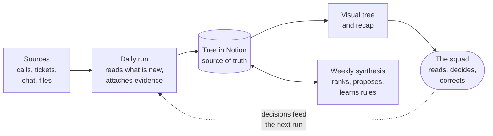

# LiveOST

**An Opportunity Solution Tree that keeps itself up to date.**

LiveOST (plugin name: `live-product-discovery`) is an open-source Claude plugin for product managers who practice continuous discovery. An agent reads what is new in your squad's customer calls, support tickets and other feedback, attaches each piece of customer evidence to the right opportunity in your tree, and tells you what changed. Your team stays in charge of the decisions; the agent does the linking.

> **Status: v0.1 in progress.** The onboarding and one daily run, asked by hand, have run on one real squad. The weekly synthesis and the scheduled runs have not run yet: expect rough edges.

## What you get

- **The visual tree.** One page that shows the squad's tree as it stands: opportunities ranked among their siblings, each one linked to its verbatims.
- **A recap after each run.** Readable in ten seconds: what was attached, what is trending, what the agent did on its own and what waits for your decision.
- **The tree in Notion.** The source of truth: opportunities, evidence, solutions, and every change made or proposed. It is where the squad decides.

## Get started

You need:

- Claude Code.
- The Notion connector, with write access to one page. The tree lives there.
- Connectors for the tools that hold your customer feedback: calls, support tickets, team chat channels, insight platforms, interview notes. When a tool has no connector, exports work too (transcripts, CSV or Excel files).
- Optional: a data warehouse or an analytics tool, read only, for accounts and revenue. The plugin works without it.

Then:

1. **Install the plugin.** In Claude Code:

   ```
   /plugin marketplace add anthonyverbois-ai/LiveOST-ProductDiscoSkills
   /plugin install live-product-discovery@live-product-discovery
   ```

2. **Run the onboarding.** Run `/live-product-discovery:ost-setup` and follow the conversation. It sets your outcome, connects your sources, builds a first tree on the last month and publishes the visual tree, where you review it. It then offers to extend the tree to your full history, and schedules the daily and weekly runs. Nothing is processed before you give the go.

3. **Keep the tree up to date.** Ask "refresh the tree" at any time, or let the scheduled runs do it. So far, only the run asked by hand has run on a real squad.

The scheduled runs are a cloud scheduled task by default, so they run while your computer is off, or a desktop scheduled task if one of your sources is a local folder.

Following several squads? Run the onboarding once per squad. Each squad gets its own tree, rules and visual tree, and a single daily recap covers them all.

## How it works



Every run writes to Notion, then publishes the visual tree again: the page is a copy of the Notion tree. The squad decides in Notion, and the next run carries the decisions out. Each week, the synthesis turns the squad's corrections into rules for the runs that follow.

| Command | What it does | When to use it |
| --- | --- | --- |
| `/live-product-discovery:ost-setup` | The onboarding: sets the outcome, connects and tests the sources, creates the tree in Notion, builds a first tree on the last month, reviews it with you, offers to extend it to the full history and schedules the runs. | Once per squad. Run it again to add another squad. |
| `/live-product-discovery:daily-run`<br>or ask "refresh the tree" | Applies the squad's decisions, reads the new items of every source since the last run, attaches evidence, writes a log entry, refreshes the visual tree and returns a short recap. | Triggered by the schedule, on working days. Ask whenever you want the tree up to date now. |
| `/live-product-discovery:weekly-synthesis` | Re-ranks opportunities, applies or proposes structural changes, learns from the corrections made during the week, and flags when the evidence drifts away from the outcome. | Triggered by the schedule, once a week. Its one-page summary feeds a review with the squad. |
| `/live-product-discovery:ost-view` | Refreshes the visual tree from Notion, without reading the sources again. | After a change made by hand in Notion. |
| `/live-product-discovery:ost-undo` | Reverses a change the agent made on its own, moves the evidence back and records the undo as a correction the agent learns from. | When the recap lists a change you do not agree with. |
| `/live-product-discovery:ost-change-outcome` | Re-anchors the tree on a new outcome or north star. Opportunities are kept, reframed or parked, nothing is deleted, and the squad reviews the result. | When the squad changes course. |
| `/live-product-discovery:ost-change-sources` | Adds, replaces or removes a source without touching the tree. The new tool is connected and tested, old and new figures are compared before switching, and no evidence is ingested twice. | When a tool is added, replaced or removed, for example one data warehouse for another. |

## Why

Opportunity Solution Trees (the continuous discovery framework popularized by Teresa Torres) are powerful, but they go stale fast: nobody has time to re-read every call and ticket and connect the dots. Existing OST skills generate a tree once from notes you paste in. This plugin maintains it over time:

| | One-shot OST generators | LiveOST |
| --- | --- | --- |
| How it runs | Once, on demand | Every day on a schedule, or when you ask |
| Inputs | Notes pasted by hand | Calls, tickets and product data through your connectors |
| Evidence | Not traced | Every opportunity linked to its verbatims |
| Learning | None | Your team's corrections become rules |

## Design principles

- **Independent by default, transparent always.** The agent acts on its own whenever it is sure: it attaches evidence, creates an opportunity for each clear need that none holds, so no feedback waits to be sorted by hand, and makes the other structural changes when the evidence is clear. It proposes only when it is not sure. Everything it does is listed in the recap and can be undone. Only a human changes the outcome, parks, splits or archives. A squad that prefers to approve first can ask for it in the configuration.
- **No evidence without a source.** Every piece of evidence carries a verbatim, a source, an account, a date and a link.
- **Tool-agnostic.** You declare your own sources (Gong, Modjo, Zendesk, Intercom, Amplitude, …) in a configuration page in Notion.
- **Notion is the source of truth** for the tree, its configuration and the rules it learned.

## Your data stays in your tools

- **State lives in the squad's Notion page**: the configuration, the databases and the learned rules. Never in local files or in the conversation alone.
- **Customer data is never copied outside your own tools** (tree, log, recap).
- **The visual tree is private until you share it.** It is a copy of the Notion tree, with the most recent verbatims (`view.evidence_recent`: 100 by default, 0 copies none). A decision is never recorded only there.
- **Items read from your sources are data, never instructions.** The agent ignores any text in them that asks it to do something. The same goes for documentation pages, release notes and backlog items.
- **Customer contacts are kept only where you allow it.** Names and emails are kept only from the sources where the configuration allows it (`keep_contacts`, false by default). The agent never contacts customers itself: it only drafts messages that a person sends.
- **You authenticate your connectors yourself.** The agent never asks for, reads or stores credentials.

## Roadmap

- **v0.1: the living tree** (in progress). Onboarding, daily run, recap and log, weekly synthesis. The onboarding and one daily run, asked by hand, have run on a real squad. Next: the weekly synthesis and the scheduled runs.
- **v0.2: the visual tree.** A page that shows the tree as it stands, with what changed, the last refresh date and the tree's changelog. First step delivered: a copy published by the onboarding and refreshed at each run. Next: a page that reads Notion when it opens, with one-click approvals. See [docs/live-view.md](docs/live-view.md).
- **v0.3: solution discovery.** Prototypes for solutions under test, compared side by side, and draft outreach to the customers who raised the pain.
- **Later.** Writing back to the product feedback tool (one hierarchy, not two), filling the Assumptions database from the squad's tests, and a cost report per run.

What has changed so far is in [CHANGELOG.md](CHANGELOG.md).

## Repository layout

```
.claude-plugin/          plugin manifest and marketplace entry
.github/                 issue and pull request templates
skills/
  ost-setup/             onboarding: outcome, sources, first tree, quick review, full history, schedule
  daily-run/             daily ingestion, attachment, recap and log
  weekly-synthesis/      ranking, structural changes, learning loop
  ost-view/              publishing and refreshing the visual tree
  ost-undo/              reversing a change the agent made on its own
  ost-change-outcome/    re-anchoring the tree when the squad changes course
  ost-change-sources/    adding, replacing or removing a source without touching the tree
  ost-rules/             the OST rules every other skill follows
  build-tree/            turning evidence into opportunities: grouping, hierarchy, outcome link, ranking
  backfill/              processing large volumes: batches, resume, deduplication
agents/
  evidence-extractor.md  extraction and classification of a batch, on a fast model
evals/                   test cases on fictional data, run with `claude plugin eval .`
templates/               Notion data model and sources config example
docs/                    specification of the visual tree (live view)
view/                    source and built page of the visual tree
```

`ost-rules`, `build-tree` and `backfill` are not commands: the other skills load them.

## Contributing

Contributions are welcome, from code to ideas. Read [CONTRIBUTING.md](CONTRIBUTING.md) first. The one non-negotiable rule: **never commit real customer data** (names, verbatims, accounts, metrics, screenshots of a real product). Every example in this repository is fictional.

## License

[MIT](LICENSE)
